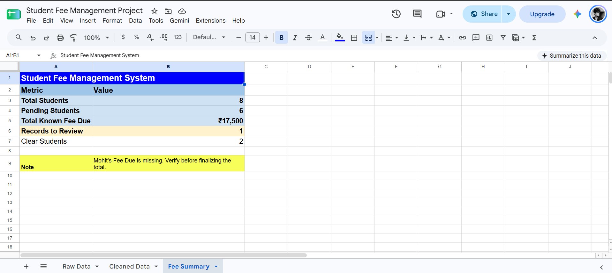
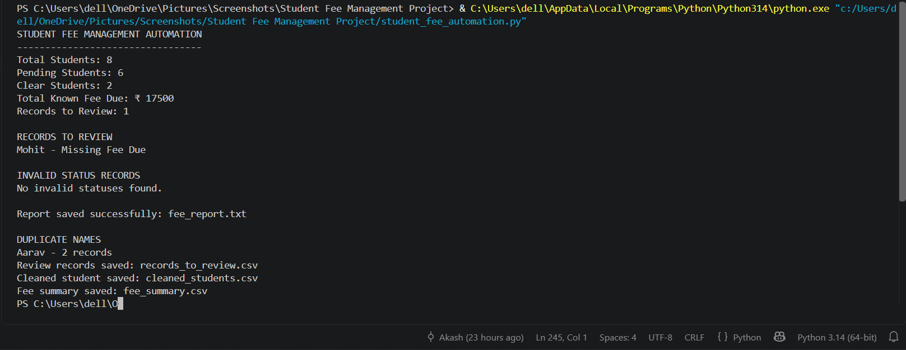

# Student Fee Management Project

A beginner-friendly business automation project combining Google Sheets and Python to organize student fee records, validate data, and generate reports.

## 1. Spreadsheet Automation

### Dashboard Preview



*Automated fee summary highlighting student counts, known fee dues, and records requiring review.*

### Live Google Sheets Project
[Open Student Fee Management Spreadsheet](https://docs.google.com/spreadsheets/d/16B4tbsKoQkpIB7IhPg0-YLZu3ToP2Fh9rp2NiPO1PMc/edit?gid=43362266#gid=43362266)
**Tool:** Google Sheets

### Features
- Counts total student records.
- Summarizes Pending and Clear students.
- Calculates total known Fee Due.
- Flags records with missing fee information.
- Highlights repeated student names for review.
- Uses formulas, conditional formatting, and data validation.
- Cleans text using TRIM and PROPER.

## 2. Python Automation

**Tools:** Python, CSV, dictionaries, lists, functions, exception handling

### Features
- Reads student records from `students.csv`.
- Calculates student counts and total known Fee Due.
- Detects missing, invalid, and negative fee values.
- Validates student status values (`Pending` and `Clear`).
- Identifies duplicate names without deleting records.
- Flags blank student names for review.
- Handles missing input files and validates CSV headers.
- Generates `fee_report.txt` automatically.
- Exports records requiring review to `records_to_review.csv`.
- Exports validated student records to `cleaned_students.csv`.
- Exports summary metrics to `fee_summary.csv`.

## Project Files

- `student_fee_automation.py` — Main Python automation script.
- `students.csv` — Fictional sample student records used as input.
- `fee_report.txt` — Generated summary and validation report.
- `cleaned_students.csv` — Export of validated student records.
- `records_to_review.csv` — Records requiring manual review.
- `fee_summary.csv` — Summary metrics exported to CSV.
- `Screenshots/` — Project screenshots for demonstration.

## How to Run the Python Script

**Prerequisites:** Python 3 installed on your system.

1. Clone or download this repository.
2. Open a terminal in the project folder.
3. Ensure `students.csv` is present in the same folder as the Python script.
4. Run the following command:

```bash
python student_fee_automation.py
```

The script processes the input CSV and generates these output files:

- `fee_report.txt`
- `cleaned_students.csv`
- `records_to_review.csv`
- `fee_summary.csv`

The script also checks input data for missing or invalid values and reports issues that require attention.

## Sample Results

The script was tested using 8 fictional student records.

| Metric | Result |
|---|---:|
| Total Students | 8 |
| Pending Students | 6 |
| Clear Students | 2 |
| Total Known Fee Due | ₹17,500 |
| Records to Review | 1 |

### Data Validation Examples

- **Missing fee:** Mohit's record is flagged for review because Fee Due is missing.
- **Duplicate names:** Two records named Aarav are retained because they have different student IDs.
- **Cleaned data:** Validated student records are exported to `cleaned_students.csv`.
- **Review records:** Records requiring attention are exported to `records_to_review.csv`.
- **Summary export:** Key metrics are saved in `fee_summary.csv`.

Missing fee values are not automatically treated as zero. This helps prevent incorrect financial summaries.

## Learning Outcomes

This project demonstrates practical spreadsheet skills, Python programming, CSV processing, data validation, and automated reporting.

## Data Disclaimer

All included student records are fictional and intended for educational and portfolio demonstration purposes.

### Python Automation Output



*Python script summary showing student counts, fee validation results, duplicate-name detection, and generated report files.*